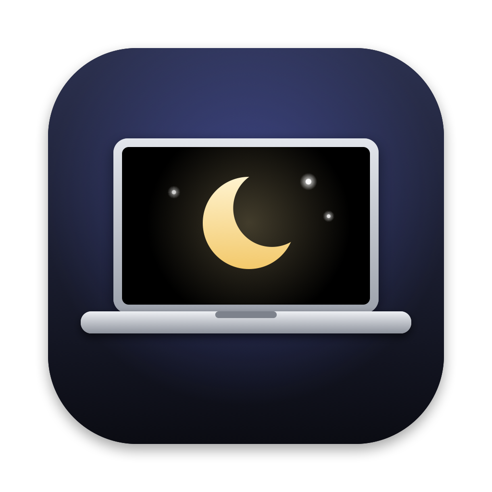

<p align="center">
  
</p>

<h1 align="center">BlackScreen</h1>

<p align="center">
  Turn off your MacBook screen. Stay focused on your movie.
</p>

<p align="center">
  <a href="https://github.com/ataberkcemunal/BlackScreen/releases/latest">
    
  </a>
</p>

---

## 🎬 Why BlackScreen?

When watching movies or TV shows at night on an external monitor, your MacBook screen can create unwanted light and break immersion.

**BlackScreen fixes this instantly** by turning your built-in display completely black while keeping your external monitor fully usable.

---

## ✨ Features

- 🎬 Perfect for movies & TV shows at night
- 🖤 Blacks out the built-in MacBook display
- 🖥️ Keeps external monitors fully usable
- 🌙 Eliminates distracting screen glow
- 💡 Restores your original brightness on exit (even after a crash or Force Quit)
- ⌨️ Exit with a click, <kbd>Esc</kbd> or <kbd>⌘Q</kbd>
- ⚡ Lightweight native macOS app (Swift), Apple Silicon + Intel
- 🎬 Smooth fade-in and fade-out
- 🧼 No Dock icon

---

## 📋 Requirements

- macOS 13 Ventura or later
- A Mac with a built-in display (MacBook)

---

## ⚙️ Usage

- Open BlackScreen
- Your MacBook display goes completely black
- External monitor remains active
- To exit, click the black screen, or press <kbd>Esc</kbd> / <kbd>⌘Q</kbd> while the pointer is over it
  (works even if another app is focused; the keys behave normally while the pointer is on the external monitor)
- Closing the lid also exits the app

---

## 🚀 Installation

1. Download **BlackScreen.dmg**
2. Open the DMG file
3. Drag **BlackScreen.app** into **Applications**
4. Launch the app

---

## ⚠️ First Launch (Important)

BlackScreen is not notarized by Apple, so macOS may show:

> “App is damaged and can’t be opened”

This is normal. To fix it, run:

```bash
# Remove macOS quarantine
xattr -cr /Applications/BlackScreen.app

# Launch the app
open /Applications/BlackScreen.app
```

---

## 🛠️ Build from source

Requires Xcode Command Line Tools (`xcode-select --install`).

```bash
./build.sh
open BlackScreen.app
```

---

## 📄 License

This project is licensed under the [MIT License](LICENSE).
